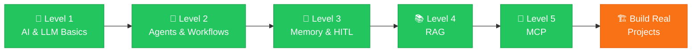

<div align="center">

# 🤖 Complete Agentic AI
### From Scratch to Advanced — with JavaScript

*A hands-on learning journey from AI & LLM fundamentals to intelligent agents, memory, RAG, and the Model Context Protocol.*

<br/>


<br/>

[🗺️ Roadmap](#️-learning-roadmap) •
[🛠️ Tech Stack](#️-technology-stack) •
[📊 Progress](#-current-progress) •
[🎯 Goals](#-learning-goals) •
[🚀 What's Next](#-whats-next)

</div>

---

## 📖 About

This repository documents my learning journey in **Agentic AI using JavaScript**, progressing from foundational concepts to advanced techniques and frameworks.

The roadmap is organised into **five levels**, covering the core concepts, architectures, frameworks, and technologies used to build modern AI-powered applications.

> 💡 **I have completed the learning phase and am now moving towards practical implementation, starting with building real-world Agentic AI applications from scratch.**

---

## 🗺️ Learning Roadmap



<details open>
<summary><h3>🧠 Level 1: AI and LLM Basics &nbsp;✅</h3></summary>

- [x] AI Fundamentals
- [x] Generative AI
- [x] Large Language Models (LLMs)
- [x] LLM Fundamentals

**Status:** 

</details>

<details open>
<summary><h3>🤖 Level 2: AI Agents and Agentic Workflows &nbsp;✅</h3></summary>

- [x] Introduction to Agentic AI
- [x] AI Agents and Agentic Workflows
- [x] Building AI Agents from Scratch — concepts and fundamentals
- [x] Tool Calling
- [x] LangChain.js
- [x] LangGraph
- [x] Connecting Agents with External Tools

**Status:**  

</details>

<details open>
<summary><h3>🧩 Level 3: Memory and Human-in-the-Loop &nbsp;✅</h3></summary>

- [x] AI Agent Memory Management
- [x] Short-Term and Long-Term Memory
- [x] Conversation History and Context Management
- [x] Human-in-the-Loop (HITL)
- [x] Human Approval and Feedback Workflows

**Status:**  

</details>

<details open>
<summary><h3>📚 Level 4: Retrieval-Augmented Generation (RAG) &nbsp;✅</h3></summary>

- [x] RAG Fundamentals
- [x] Document Processing and Chunking
- [x] Vector Embeddings
- [x] Semantic Search
- [x] Vector Databases
- [x] Building RAG Applications — concepts and workflow

**Status:**  

</details>

<details open>
<summary><h3>🔌 Level 5: Model Context Protocol (MCP) &nbsp;✅</h3></summary>

- [x] MCP Fundamentals
- [x] MCP Architecture
- [x] MCP Host, Client, and Server
- [x] Building MCP Servers with JavaScript — concepts and fundamentals
- [x] Connecting AI Agents with MCP Tools
- [x] MCP-Powered Applications — concepts and architecture

**Status:**  

</details>

---

## 🛠️ Technology Stack

| Category | Technologies |
|:---|:---|
| 💻 **Programming Language** |  |
| ⚙️ **Runtime Environment** |  |
| 🧠 **AI Fundamentals** | Generative AI · LLMs · Prompt Engineering |
| 🔗 **AI Frameworks** | LangChain.js · LangGraph |
| 🤖 **Agentic AI** | AI Agents · Tool Calling · Agentic Workflows |
| 🧩 **Memory Management** | Conversation History · Context Management · Long-Term Memory |
| 🙋 **Human-in-the-Loop** | Human Approval and Feedback Workflows |
| 📚 **RAG** | Document Processing · Chunking · Embeddings · Semantic Search |
| 🗄️ **Vector Databases** | Vector Storage and Retrieval |
| 🔌 **MCP** | Model Context Protocol · MCP Architecture · Servers and Clients |
| 🌐 **Integration** | External Tools and REST APIs |

---

## 📊 Current Progress

| Level | Learning Area | Learning | Projects |
|:---:|:---|:---:|:---:|
| 1️⃣ | AI and LLM Basics | ✅ Completed | ⏳ Not started |
| 2️⃣ | AI Agents and Agentic Workflows | ✅ Completed | ⏳ Not started |
| 3️⃣ | Memory and Human-in-the-Loop | ✅ Completed | ⏳ Not started |
| 4️⃣ | Retrieval-Augmented Generation (RAG) | ✅ Completed | ⏳ Not started |
| 5️⃣ | Model Context Protocol (MCP) | ✅ Completed | ⏳ Not started |

**Overall**

```text
Learning  [██████████████████████████████] 100%
Projects  [░░░░░░░░░░░░░░░░░░░░░░░░░░░░░░]   0%  ← starting now 🚀
```

> **Current Phase: Moving from Learning to Building 🚀**
>
> The conceptual learning phase is complete. My next goal is to strengthen my understanding through hands-on coding, practical implementations, and real-world AI applications.

---

## 🎯 Learning Goals

- [ ] 🧠 Understand the fundamentals of LLMs and how they power AI applications
- [ ] 🤖 Build AI agents using JavaScript and Node.js
- [ ] 🔧 Implement tool calling and multi-step agentic workflows
- [ ] 🔗 Work with LangChain.js and LangGraph to orchestrate AI agents
- [ ] 🧩 Implement short-term and long-term memory for AI agents
- [ ] 📚 Develop RAG applications using embeddings and vector databases
- [ ] 🔌 Build MCP servers and connect AI agents with external tools
- [ ] 🏗️ Apply these concepts to develop practical, real-world Agentic AI applications

---

## 🚀 What's Next?

With the learning phase complete, I am now starting the **practical implementation phase**.

| Step | Focus | Status |
|:---:|:---|:---:|
| 1 | Build AI agents from scratch using JavaScript | 🔜 Upcoming |
| 2 | Implement tool calling and agentic workflows | 🔜 Upcoming |
| 3 | Experiment with LangChain.js and LangGraph | 🔜 Upcoming |
| 4 | Develop memory-enabled AI agents | 🔜 Upcoming |
| 5 | Build RAG applications with vector databases | 🔜 Upcoming |
| 6 | Create MCP servers and integrate them with AI agents | 🔜 Upcoming |
| 7 | Develop end-to-end Agentic AI applications | 🔜 Upcoming |

> 📝 **No projects have been completed as part of this learning roadmap yet. The project-building phase starts now, and I will document my implementations as I progress.**

---

## 📌 Repository Purpose

This repository serves as a record of my Agentic AI learning journey, documenting the concepts I have studied and the practical implementations I build along the way.

The goal is to move beyond understanding AI concepts and develop the skills required to **design, build, and deploy intelligent AI-powered applications.**

---

<div align="center">

### ✨ Learning the concepts. Building the skills. Now turning knowledge into real-world applications. 🚀

⭐ *Star this repo to follow along as I start building!* ⭐

</div>